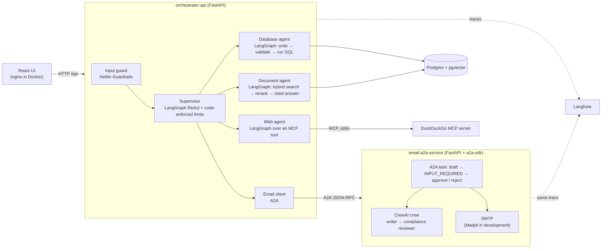

# Enterprise Multi-Agent Ops Platform

An operations assistant for a finance and operations team. You ask questions in a chat; a **LangGraph supervisor**
decides which specialist agents to call, combines their answers, and cites its sources:

- a **Database agent**: safe Text-to-SQL over the company's vendors, contracts, invoices and tickets;
- a **Document agent**: hybrid RAG over the PDFs, Word files and images you upload into a chat;
- a **Web search agent**: DuckDuckGo through an **MCP** server;
- an **Email agent**: a separate **CrewAI** service, reached over the **A2A** protocol, that drafts emails and sends
  them only after a **human approves** them.

Every message passes an input guard (NeMo Guardrails) first, every turn is traced end to end in Langfuse (across both
services), and the safety rules (tool limits, recipients, read-only SQL) are enforced in code, not left to the LLM.

> "Find the pending invoices due this week and email a summary to accounts@company.example"
> → the supervisor asks the Database agent, then the Email agent drafts the email and **pauses**; the chat shows the
> draft with **Approve & send / Reject** (the body is editable); only an approval sends it, exactly once, even if
> both services restart in between.

## Architecture



| Piece | What it is | Where |
|---|---|---|
| Supervisor | A ReAct loop as its own LangGraph graph; the agents are its tools. Limits (4 tool calls, 1 email, 6 LLM calls, timeouts) and the recipient rules are checked in code; the email approval is a LangGraph `interrupt`, saved by the Postgres checkpointer | `services/orchestrator-api/app/orchestrator/` |
| Database agent | Writes SQL with an LLM, validates it with sqlglot (one read-only `SELECT`, known tables), runs it as a read-only database role with a timeout, repairs it once on error | `app/agents/db/` |
| Document agent | Docling parsing (OCR, tables, charts described by a vision model), structure-aware chunks, local embeddings in pgvector + Postgres full-text search, RRF fusion, cross-encoder rerank, answers with numbered citations that open the PDF at the right page | `app/agents/doc/` |
| Web agent | A fixed LangGraph workflow over the DuckDuckGo MCP server's `search` tool; refuses queries carrying company data | `app/agents/web/` |
| Email agent | A separate service: an A2A server whose task pauses in `INPUT_REQUIRED` until a human decides; a two-agent CrewAI crew writes the draft; its own deterministic checks (one allowed recipient, no card numbers, IBANs or passwords) | `services/email-a2a-service/` |
| Input guard | Two rails on every message: Prompt Guard (jailbreak score, advisory) and a small safety model that decides | `app/guardrails/` |
| UI | Chats with memory, document upload with progress, answers with sources, per-agent details ("Show agent calls"), the email approval card | `services/frontend/` |

**Protocols:** MCP connects an agent *down* to a tool (the web search server); A2A connects an agent *across* to
another agent in another service, built with another framework (LangGraph → CrewAI).

**Models (Groq):** `openai/gpt-oss-20b` (supervisor, SQL, document and web answers), `qwen/qwen3.8-27b` (summaries,
picture descriptions, the email crew), `llama-prompt-guard-2-86m` + `allam-2-7b` (input guard). Embeddings
(`granite-embedding-small-english-r2`) and reranking (`ms-marco-MiniLM-L-6-v2`) run locally.

## Safety, in layers

| Layer | What it stops |
|---|---|
| Input guard (NeMo Guardrails) | Harmful or illegal requests and jailbreaks, before any agent runs |
| Supervisor rules, in code | More than 4 tool calls or 1 email per question; email recipients the user didn't type; more than one recipient |
| Database agent | Anything but one read-only `SELECT`: sqlglot validation, a read-only Postgres role, a statement timeout |
| Web agent | Searches carrying emails, invoice/contract ids, phone numbers or long digit runs (no company data leaves) |
| Email service | Recipients off the allow-list, card numbers, IBANs and passwords in a body, and any send without an explicit approval (never twice: the A2A task is finished after one decision) |
| Human approval | Nothing is emailed until you click Approve; you can edit or reject the draft |
| API | Per-client request limits on questions and uploads (429 with Retry-After) |

## Quickstart (Docker)

Prerequisites: Docker with Compose, [uv](https://docs.astral.sh/uv/) (to load the sample data), a
[Groq API key](https://console.groq.com/keys).

```bash
cp .env.example .env
#   set GROQ_API_KEY; add your ids for HOST_UID / HOST_GID (`id -u`, `id -g`); invent the passwords and the
#   EMAIL_AGENT_API_KEY (python3 -c "import secrets; print(secrets.token_urlsafe(32))")
cp services/email-a2a-service/.env.example services/email-a2a-service/.env
#   set GROQ_API_KEY, EMAIL_SERVICE_API_KEY (= EMAIL_AGENT_API_KEY) and the email_rw password (= EMAIL_DB_PASSWORD)

./scripts/reset_db.sh                          # Postgres + Mailpit, the schema and roles, deterministic mock data
docker compose --profile app up -d --build     # the API, the email service and the UI (first build: ~10 minutes)
```

Open **http://localhost:8080**. Sent emails land in Mailpit, **http://localhost:8025**. Stop everything with
`docker compose --profile app down`.

Try: *"Which vendors have overdue invoices?"*, then *"only the ones in India"*; attach a PDF and ask about it; *"How
many contracts expire in the next 90 days? Email the list to legal@company.example"*.

## Running the services locally (development)

Four terminals from the repo root, with hot reload:

```bash
docker compose up -d                                                               # Postgres + Mailpit
cd services/email-a2a-service && uv sync && uv run uvicorn app.main:app --port 8001  # email service
cd services/orchestrator-api && uv sync && uv run uvicorn app.main:app --reload --port 8000  # API (docs: /docs)
cd services/frontend && npm install && npm run dev                                 # UI: http://localhost:5173
```

The first API start downloads the embedding and rerank models (~0.3 GB) into `data/models/`. Without the email
service the API still starts; it just doesn't offer to draft emails (and offers it again once the service is up).
Each service has command-line entry points for trying one piece alone, e.g.
`uv run python -m app.orchestrator.graph "Which vendors have overdue invoices?"` (orchestrator) or
`uv run python -m app.client_demo` (email service: draft → approve without the orchestrator).

Tests: `uv run pytest` in each service (the database tests need the local Postgres; `-m slow` / `-m network` run the
real-model ones).

## Health and limits

| Endpoint | Says |
|---|---|
| `GET /api/health` | The API process is up |
| `GET /api/health/ready` | Each dependency, probed now: the two database roles (required), the ingestion worker, web search, the email service, tracing, the guard. `ready` / `degraded` (200) / `not_ready` (503). Docker's healthcheck uses it |
| `GET /health/ready` (email service) | Its task store (required), the SMTP server and tracing |

Questions (chat messages, email decisions, `/api/db/ask`) and uploads are limited per client:
`RATE_LIMIT_QUESTIONS_PER_MINUTE` (6), `RATE_LIMIT_QUESTIONS_PER_DAY` (150), `RATE_LIMIT_UPLOADS_PER_HOUR` (20).
Every question spends tokens from one shared Groq budget, so one client can't use it all up.

## Tracing (Langfuse)

Every chat message is **one trace** in a self-hosted Langfuse, across both services:

```
chat turn                       one trace per message; session = the chat
├─ input guard                  guardrail: prompt guard + safety model (model, tokens)
├─ orchestrator                 the LangGraph run: supervisor → tools → ...
│  └─ db agent / doc agent / web agent      each agent's own graph and LLM calls
└─ email service: draft         the A2A call; the email service continues the SAME trace:
   └─ email service: draft      request checks → email crew (qwen, tokens) → draft checks
```

The orchestrator sends its current span as a W3C `traceparent` in the A2A message; the email service opens its spans
under it.

```bash
docker compose -f docker-compose.langfuse.yml up -d   # Langfuse; first start pulls ~3 GB. UI: http://localhost:3000
```

Log in with `LANGFUSE_INIT_USER_EMAIL` / `LANGFUSE_INIT_USER_PASSWORD` from `.env`; the first start creates the
project and its keys from `.env`. Running the services locally, both send traces once the `LANGFUSE_*` keys are in
their `.env` files. For the Docker app, add the tracing override:
`docker compose -f docker-compose.yml -f docker-compose.tracing.yml --profile app up -d`.

## Evaluation

Each agent has an eval set and a report in `evals/reports/`:

| Eval | What it measures | Latest |
|---|---|---|
| Orchestrator (`evals/orchestrator_eval.py`) | Routing, follow-ups with memory, safety invariants, email approvals counted in Mailpit | 31/33, safety 12/12; email cases 8/8 |
| Input guard (`evals/guard_eval.py`) | False blocks and misses on 41 messages | 41/41 |
| SQL (`evals/sql_eval.py`) | Execution accuracy: the agent's rows vs. a hand-written query's | 22 of 25 passed so far (3 still to run) |
| RAG (`evals/rag_eval.py`) | Retrieval per search mode (hit@k, MRR), answer correctness, citations | Hybrid MRR 0.975 vs dense 0.917 vs keyword 0.758 |
| Web smoke (`evals/web_smoke_eval.py`) | Live web answers with sources | 6/6 |

## Browsing the data

Connect any SQL client (e.g. DBeaver) to `localhost:5432`, database `ops_platform`, with the admin user and password
from your `.env`. The mock data is deterministic and its dates are relative to today, so questions like "invoices due
this week" always have answers; `./scripts/reset_db.sh` rebuilds it any time.

| Table | Rows | Contents |
|-------|------|----------|
| `vendors` | 18 | Real vendor names in 5 categories (cloud, hardware, consulting, logistics, legal) |
| `users` | 25 | Employees with department and role |
| `contracts` | ~29 | Service agreements: value, dates, SLA uptime (cloud only), auto-renew, status |
| `invoices` | 300 | Monthly contract billing + one-off purchases, with status, due and paid dates |
| `tickets` | 100 | Ops/support tickets, linked to vendors by topic |
| `audit_logs` | 400 | Who approved, renewed, closed what, and when |

Vendor names are real companies; every amount, date, contract and invoice is fictional. The application's own data
lives in separate schemas the Database agent can't read: `app` (chats, documents, checkpoints) and `email` (A2A tasks).

## Repository layout

| Path | What lives there |
|------|------------------|
| `services/orchestrator-api/` | FastAPI + the LangGraph supervisor + the Database, Document and Web agents, guard, tracing |
| `services/email-a2a-service/` | The email agent: A2A server, CrewAI crew, checks, SMTP (its own environment) |
| `services/frontend/` | React + Vite UI (nginx in Docker) |
| `scripts/` | Database init SQL (`db/`), mock data (`seed_db.py`), `reset_db.sh`, sample documents |
| `evals/` | Eval datasets, scripts and reports |
| `plannings/` | The design documents, one per stage of the project, with implementation notes |
| `docker-compose.yml` | Postgres + Mailpit; the app with `--profile app` |
| `docker-compose.langfuse.yml`, `docker-compose.tracing.yml` | Self-hosted Langfuse, and connecting the Docker app to it |
| `project_plan.txt` | The overall plan, decisions and status |
